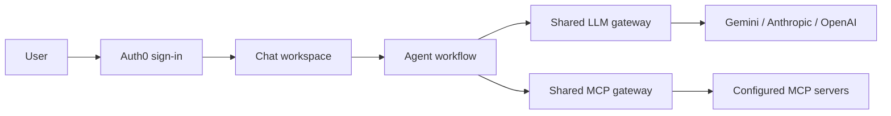

# Agent Lab


**A chat workspace for testing agent workflows with Auth0 authentication and shared gateways for models and tools.**

Agent Lab is a reusable platform for testing different agents through one chat interface. The research agent is its first implementation. New agents can reuse the same authentication, model gateway, tool gateway, and connection UI.

<details>
<summary>View the sign-in screen</summary>

Users sign in before they can access the workspace.


</details>

## Available agents

| Agent | Purpose | Models | Tools |
| --- | --- | --- | --- |
| **Research agent** | Research a question, collect evidence, and return an answer with source references and checked quotations | Gemini, Anthropic, or OpenAI through the shared LLM gateway | Tavily web search and the allowlisted internal MCP tools below |

The research agent is currently registered. Additional local workflows, HTTP agents, and A2A agents can be added through the code registry.

## Configured tools and integrations

| Tool or service | Integration | Available to | Purpose | Connection requirement |
| --- | --- | --- | --- | --- |
| **Web search** | Tavily API | Research agent | Find source material for a research question | Backend `TAVILY_API_KEY` |
| **`whoami`** | Internal MCP server | Research agent | Read the authenticated user's account identity | User connects the internal MCP service |
| **`list_orders`** | Internal MCP server | Research agent | List the authenticated user's orders | User connects the internal MCP service |
| **`get_order`** | Internal MCP server | Research agent | Retrieve an order the user is authorized to access | User connects the internal MCP service |

These tables describe the current configuration, not a live connection status. Internal MCP tools require the external service to be running and the user's authorization to be valid. Each agent's server and tool permissions are defined in [`registry.py`](platform_app/registry.py); adding a server does not automatically grant every agent access to it.

## Stage 1 — Build the agent platform

The foundation provides the shared capabilities that local agents plug into:

- **One chat workspace** with Auth0 sign-in and backend sessions.
- **An LLM gateway** for model routing and provider calls through LiteLLM.
- **An MCP gateway** for server connections, tool discovery, credential storage, and permission checks.
- **A code-driven agent registry** defining each agent's workflow and allowed tools.
- **HTTP and A2A adapters** for testing externally hosted agents.

These capabilities belong to the platform. Adding a local agent means implementing its workflow and registering it, while reusing the existing login, gateways, and interface.

## Stage 2 — Add the research agent

The first agent lives in [`platform_app/agents/research/`](platform_app/agents/research/). It demonstrates how a workflow uses the platform:

1. Receive a question from the chat workspace.
2. Request model responses through the shared LLM gateway.
3. Gather evidence using Tavily web search and permitted MCP tools.
4. Check source references and exact quotations before accepting a final answer.
5. Save the result under the signed-in user's identity.

Its research loop, prompts, and evidence checks are agent-specific. Authentication, model requests, MCP connections, and tool authorization are supplied by the platform.

### Add the next agent quickly

1. Create its workflow under `platform_app/agents/<agent_name>/`, using the shared `tools` and `llm` interfaces.
2. Register the workflow in [`LOCAL_WORKFLOWS`](platform_app/workflows.py).
3. Add an `AgentSpec` in [`AGENTS`](platform_app/registry.py), setting its `workflow` and any `MCPBinding` tool permissions.
4. Restart the backend. The agent appears automatically in the existing chat picker.

Register a new MCP server once in `MCP_SERVERS`; any local agent can then be granted a tool allowlist for that server. Existing servers and user connections can be reused. Each agent still receives only its own permitted tools.

## Technology stack

| Technology | How it is used |
| --- | --- |
| **Python 3.12 + FastAPI** | Backend routes, agent execution, login callbacks, and connection management |
| **HTML, CSS, and JavaScript** | A lightweight chat interface without a frontend framework or build step |
| **Auth0** | Hosted sign-in, access-token verification, and user authorization for the existing OAuth-protected MCP service |
| **LiteLLM SDK** | A common model interface for Gemini, Anthropic, and OpenAI, behind the platform's LLM gateway |
| **Model Context Protocol (MCP)** | Tool discovery and execution through one shared MCP gateway |
| **Tavily** | Web search and source material for the research workflow |
| **SQLite + Fernet encryption** | Local persistence, with encrypted platform sessions and MCP credentials |
| **HTTP + A2A v0.3** | Outbound adapters for testing externally hosted agents |
| **pytest** | Offline checks for authentication, authorization, gateways, research execution, and evidence validation |

## How the platform works

Sign in, select an agent, and send a message. The platform supplies the workflow with two shared interfaces: one for model calls and one for its allowed tools. When a mapped tool service needs user authorization, the chat offers a Connect or Reconnect action.



### Shared gateways

**LLM gateway — [`gateway/llm.py`](platform_app/gateway/llm.py)**

All model calls made by local workflows pass through this module. It owns LiteLLM requests, configured model routes, provider credentials, timeouts, output limits, and sanitized errors. Agent prompts and research decisions stay in the workflow. Automatic retries and fallbacks are disabled, keeping provider usage bounded and predictable.

**MCP gateway — [`gateway/service.py`](platform_app/gateway/service.py)**

Agents use the same connection, discovery, and tool-execution layer. They do not create their own MCP bridges or manage MCP tokens. The gateway can combine multiple servers, naming their tools as `server__tool` to avoid collisions. It supports the existing Auth0 OAuth flow, configured Bearer API keys, and explicitly configured public servers. Other OAuth issuers need a connector added at the gateway.

Both gateways run inside the backend process. Externally hosted HTTP/A2A agents control their own model and tool calls; the adapters do not automatically route those external calls through these gateways. A2A support covers v0.3 JSON-RPC direct replies and completed tasks; streaming and task polling are not implemented.

### Code-driven agents and permissions

The source of truth is [`platform_app/registry.py`](platform_app/registry.py):

- **`MCP_SERVERS`** registers each trusted tool server once.
- **`AGENTS`** registers agents and maps each one to permitted servers and tool names.
- **`MCPBinding.required`** determines whether a missing connection blocks the workflow.

For example, the research agent can be granted access to the internal account and order tools:

```python
AgentSpec(
    "research",
    "Research agent",
    "Research with sources and verified quotations.",
    connections=(
        MCPBinding("internal", ("whoami", "list_orders", "get_order")),
    ),
)
```

Register local workflow implementations in [`platform_app/workflows.py`](platform_app/workflows.py). Each receives the shared `tools` and `llm` interfaces. Adding another workflow does not require another connection bridge or a new chat UI.

Tool discovery provides descriptions and argument schemas; it does not grant access. Permission mappings live in code, while user connections live in encrypted storage.

## Authentication and security

### Auth0 sign-in comes first

The workspace requires a valid platform session. Unauthenticated users see the sign-in screen, and the state, chat, and connection APIs reject unauthenticated requests.

Login uses **Auth0 Authorization Code with PKCE S256**. The backend verifies the returned access token using the configured Auth0 issuer and API audience, requires a user subject and expiry, and checks for the `research:run` scope. A short-lived, single-use state value and a browser-bound cookie protect the login callback.

The browser receives an opaque **HttpOnly, SameSite=Lax session cookie**. Access tokens remain on the backend and are not exposed to browser JavaScript. Cookies also use the Secure flag when the configured platform origin is HTTPS. Expired sessions require sign-in again; signing out deletes the local platform session.

### Tool access is separate from platform login

Signing in identifies the user; connecting an OAuth-protected MCP service authorizes access to that service. The existing MCP connector uses discovery, Dynamic Client Registration where needed, and Authorization Code with PKCE. Callback state is single-use and expires, OAuth endpoints are restricted to the trusted Auth0 tenant, and the MCP token must match the platform user and registered client.

Connections are stored per user and server. Several agents can reuse the same user's connection, but each receives only its own allowlisted tools. The gateway filters discovered tools and checks the mapping again before execution. Tool arguments are validated against the discovered schema.

Expired or revoked OAuth connections trigger reconnection. No refresh tokens are requested. Bearer API-key connections are backend-managed service credentials rather than individual user grants. Remote HTTP/A2A adapters use their own configured credentials and do not receive the platform user's access tokens or MCP tokens.

### Storage and request protection

- **Encrypted credentials:** platform sessions, MCP tokens, and registered MCP client IDs are encrypted in `data/platform.sqlite3`. The local Fernet key is stored in `data/vault.key` with owner-only permissions.
- **Request checks:** state-changing requests require the configured origin. Logout also supports a session-bound form token for browsers that omit the Origin header. Host validation restricts the local application hosts.
- **Secret handling:** `.env`, runtime databases, the encryption key, and the virtual environment are excluded from Git. Provider failures return safe error codes rather than raw upstream responses.
- **Bounded execution:** default research limits are 8 model calls, 12 tool calls, and 90 seconds per run, with up to two workflows running concurrently. Provider rate and daily quotas still apply.
- **Evidence checks:** research claims must reference collected sources and matching quotations. Quote matching confirms text presence; it does not independently establish factual accuracy. Retrieved content is treated as untrusted input.

**POC boundaries:** research questions, results, and short tool traces are stored per user in a separate SQLite database without application-level encryption. Questions and relevant evidence, including private tool results when used, are sent to the selected model provider. Chat history stays in browser memory, and each message starts an independent research run. Pending OAuth flows do not survive a restart. The current setup is intended for one local backend process, not a production deployment.

## Run locally

### 1. Install

You need **Python 3.12**, an Auth0 tenant, a supported model-provider API key, and a Tavily key for web research. MCP services are optional for web-only research and must be running separately when testing their tools.

```sh
git clone https://github.com/saurabhlanjewar/agent-platform.git
cd agent-platform

python3.12 -m venv .venv
.venv/bin/pip install -r requirements.lock
.venv/bin/pip install --no-deps -e .

# Fresh installations only; keep your existing .env if already configured.
cp .env.example .env
```

### 2. Configure Auth0

Create or reuse an Auth0 API with the identifier `https://research-agent.local/api` and permissions `research:run` and `research:read`.

Configure a public application for Authorization Code with PKCE and token-endpoint authentication set to `none`. Authorize it for the research API permissions and add this allowed callback URL:

```text
http://localhost:8010/auth/callback
```

Copy its public client ID, your tenant domain, and the API identifier into `.env`. The domain must be a hostname without `https://`. If API RBAC is enabled, assign the research permissions to your test user as well.

### 3. Configure the model and search

For Gemini, set these values in `.env` using your own credentials:

```dotenv
PLATFORM_CLIENT_ID=your-auth0-public-client-id
PLATFORM_ORIGIN=http://localhost:8010
AUTH0_DOMAIN=your-tenant.us.auth0.com
AUTH0_AUDIENCE=https://research-agent.local/api

LLM_PROVIDER=gemini
GEMINI_MODEL=gemini-3.1-flash-lite
GEMINI_API_KEY=your-gemini-api-key
TAVILY_API_KEY=your-tavily-api-key
```

Choose a model available to your account. To use another provider, set `LLM_PROVIDER=anthropic` or `LLM_PROVIDER=openai` and supply the corresponding key and model variables from [`.env.example`](.env.example). Platform `.env` values take precedence over inherited environment variables. Restart after changing settings.

### 4. Configure MCP tools, if needed

Register the service in `MCP_SERVERS` and bind its allowed tools to an agent in [`registry.py`](platform_app/registry.py). The included `internal` entry expects a separately running MCP server at `http://localhost:3000/mcp`; that server and its downstream API are not bundled in this repository.

For the existing Auth0 OAuth connector, use the same trusted tenant and authorize the MCP client for `mcp:access`. The platform callback is:

```text
http://localhost:8010/mcp/callback
```

Set `MCP_SERVER_URL` to the service endpoint. Leave `MCP_CLIENT_ID` empty for DCR, or provide an authorized public client with that callback. DCR must be enabled when used, and tenant consent or administrator approval may be required. The platform does not grant Auth0 permissions automatically.

The research agent's internal-tool binding is optional: without a connection, it can still research the web using Tavily. Once connected, those tools become available automatically.

### 5. Start the app

```sh
.venv/bin/uvicorn platform_app.app:create_app --factory \
  --host 127.0.0.1 --port 8010 --no-access-log
```

Open **[http://localhost:8010](http://localhost:8010)**, sign in, and select an agent. Use `localhost` consistently so the configured origin and callbacks match. Access logging is disabled to keep OAuth callback codes out of request logs.

Run the offline checks with:

```sh
.venv/bin/python -m pytest tests -q
```
