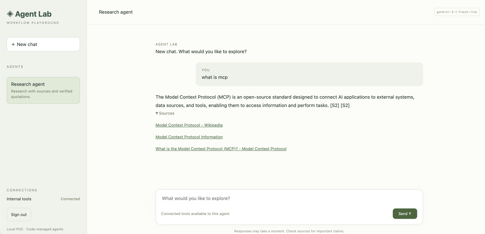
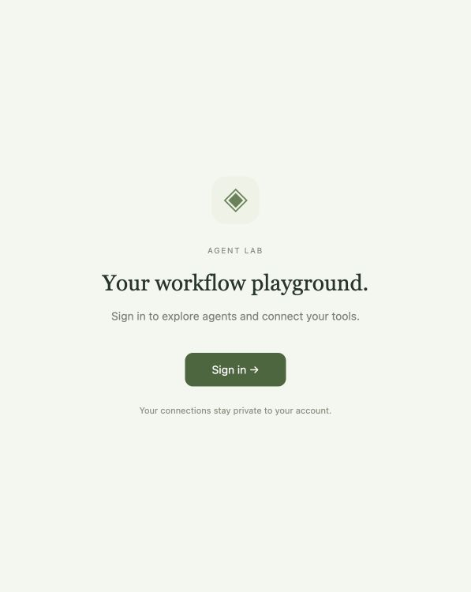

# Agent Lab

A standalone local agent platform with a sign-in-first chat workspace. The research workflow, execution loop and citation checks live under `platform_app/agents/research/`. Model calls and MCP connections live in the shared platform gateway under `platform_app/gateway/`. The old sibling research project is no longer a runtime or installation dependency.

## Preview

Research workspace with connected internal tools, a model response, and source links:



Users sign in before entering the workspace:



## Run

From this directory (Python 3.12):

```sh
python3.12 -m venv .venv
.venv/bin/pip install -r requirements.lock
.venv/bin/pip install --no-deps -e .
cp .env.example .env  # only on a fresh installation; preserve an existing .env
.venv/bin/uvicorn platform_app.app:create_app --factory --host 127.0.0.1 --port 8010 --no-access-log
```

Open http://localhost:8010. Unauthenticated users see only the sign-in page. The workspace and state/chat/connection APIs require a valid server-side session. Expired sessions return users to sign-in. Sign out deletes the local platform session.

All settings now come from this project's `.env`; existing settings were migrated locally without displaying keys. Platform `.env` values take precedence over inherited environment variables. Configure an Auth0 public application using PKCE, authorized for the research API's `research:run research:read` scopes, with callback `http://localhost:8010/auth/callback`. Set its public ID as `PLATFORM_CLIENT_ID`. MCP callbacks use `http://localhost:8010/mcp/callback`. Use `localhost` consistently in the browser. The platform does not automatically change Auth0 tenant grants.

The internal MCP and internal API are independent external tool services; start them as described in the parent README when testing private account/order tools.

## Register agents and tools

Edit `platform_app/registry.py` and restart:

```python
AgentSpec(
    'research', 'Research agent', 'Research with sources.',
    connections=(MCPBinding('internal', ('whoami', 'list_orders', 'get_order'), required=False),),
)
```

The server registry defines trusted MCP endpoints and OAuth settings. Each agent binding defines that workflow's exact tool allowlist and whether a connection is required. Discovery fetches schemas only from configured MCP servers, then filters to the selected agent's allowlist. Browser requests cannot choose a server or widen tool access.

Selecting an agent shows only its mapped connections. The sidebar shows connection status; a single action in chat connects each missing service. Connected optional tools are automatically available to the workflow. Missing optional tools do not prevent web research. Required or expired previously granted connections stop the run and ask for connection/reconnection. A user's connection is reused by all agents mapped to that service, while tool access remains specific to each agent. The gateway combines tools from multiple mapped servers in one run, prefixing their names with `server__` to avoid collisions. It checks the agent allowlist during discovery and again at call time.

- `local`: bundled research workflow with bounded execution and optional mapped MCP tools.
- `http`: POST `{question, use_mcp}` to a fixed endpoint; return `{answer, status, sources?}`.
- `a2a`: outbound A2A v0.3 JSON-RPC `message/send`, with direct text Messages or completed Task artifacts. No polling, streaming, push notifications, or A2A v1 support.

Remote agents use their own `token_env` credentials. Platform user/MCP tokens are never forwarded to them; remote tool use belongs to the remote workflow. Registry validation prevents assigning platform MCP bindings to these adapters.

## Shared MCP gateway

The gateway is a shared backend service in this process, not a separately deployed proxy. Agents receive a credential-free interface with `describe()`, `call(name, arguments)`, and `resource_for(name)`. No agent creates an MCP bridge, handles OAuth callbacks, stores MCP tokens, or selects arbitrary MCP endpoints.

Configuration is code-driven:

| File | Responsibility |
| --- | --- |
| `platform_app/registry.py` → `MCP_SERVERS` | Register a trusted server once, including endpoint and authentication mode |
| `platform_app/registry.py` → `AGENTS[].connections` | Agent → server → allowed tool names, plus required/optional status |
| `platform_app/workflows.py` → `LOCAL_WORKFLOWS` | Register local workflow implementations using the same tool interface |
| `platform_app/gateway/service.py` | Connection lifecycle, per-user state, agent policy, multiple-server routing |
| `platform_app/gateway/connections.py` | Shared SDK transport, OAuth discovery/PKCE, schema validation and dispatch |

Mappings are stored in source code, not SQLite. SQLite stores user connection credentials and research results. Discovery supplies tool descriptions and schemas; it does not grant permissions or change mappings.

Register a third-party API-key server centrally:

```python
MCP_SERVERS['vendor'] = {
    'name': 'Vendor tools', 'auth': 'api_key', 'token_env': 'VENDOR_MCP_KEY',
    'overrides': {'mcp_server_url': 'https://vendor.example/mcp'},
}
```

Then add `MCPBinding('vendor', ('lookup',))` to any local agent. Its workflow sees `vendor__lookup`, alongside any other allowed tools. Set the key only in the platform environment. `auth='none'` supports explicitly configured public servers. Both are platform-managed service access, not individual user grants, and the UI does not ask the user to reconnect these credentials.

`auth='oauth'` uses the existing Auth0 DCR/PKCE connector, with encrypted per-user credentials. OAuth endpoints must belong to the configured trusted Auth0 tenant. Other OAuth issuers require a connector added once at the gateway; generic third-party OAuth is not implemented. Existing user MCP connections retain the same vault keys through this refactor. Revoked/expired OAuth credentials prompt reconnection.

## Shared LLM gateway

`platform_app/gateway/llm.py` is the single entry point for all model calls made by local platform workflows. LiteLLM is imported and invoked only here. It handles registered provider/model routes, backend credentials, SDK configuration, timeouts, output-token caps, retry policy and sanitized provider errors. It currently uses Gemini, Anthropic and OpenAI routes from the platform settings. Unknown routes and missing keys fail before a provider request is sent.

The platform creates one shared `LLMGateway` at startup and injects it into local workflows alongside the MCP tool interface:

```python
async def run(question, owner, settings, client, store, tools, llm):
    response = await llm.complete(
        [{'role': 'user', 'content': question}],
        provider='gemini',  # optional: defaults to the configured provider
    )
```

Agent-specific prompts, tool schemas, history conversion and response interpretation remain in the workflow. The research provider adapter delegates its model request to `llm.complete()`; it retains its Tavily search request, which is not an LLM call. A standalone research API also uses this gateway. External HTTP/A2A services control their own internal model calls; the platform cannot route those calls unless that service integrates with the gateway.

No automatic retry or fallback is added. Existing execution budgets and provider quotas still apply. The gateway is an in-process service, not a deployed LiteLLM proxy. No prompt logging or usage database is introduced by this change.

## State and verification

Server sessions and MCP tokens/client IDs persist encrypted in `data/platform.sqlite3`. Keep `data/vault.key` private. Pending OAuth flows remain in memory; reconnect after a restart during login. No refresh tokens are requested. Final research results are stored per user in `data/research.sqlite3`; chat history is browser-memory only and each question starts an independent research run.

Run one process bound to loopback. Up to two workflows run concurrently; tool bindings are request-scoped and do not mutate shared agent state. This is a local POC, not an internet deployment configuration. LiteLLM handles model calls for Gemini, Anthropic and OpenAI, with automatic retries disabled. One research run can make several model requests; provider quotas still apply.

```sh
.venv/bin/python -m pytest tests -q
```
